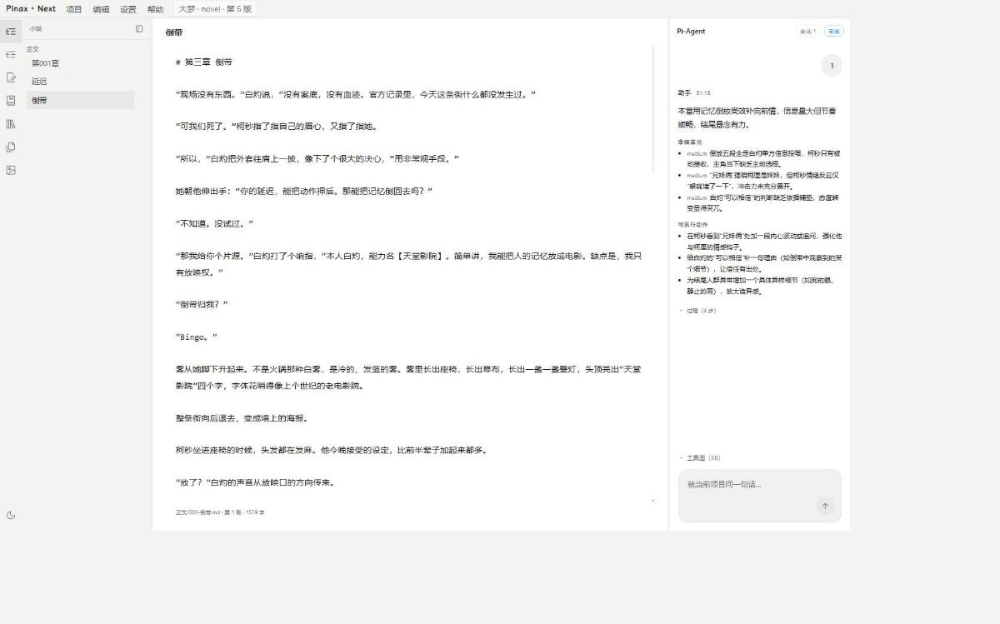
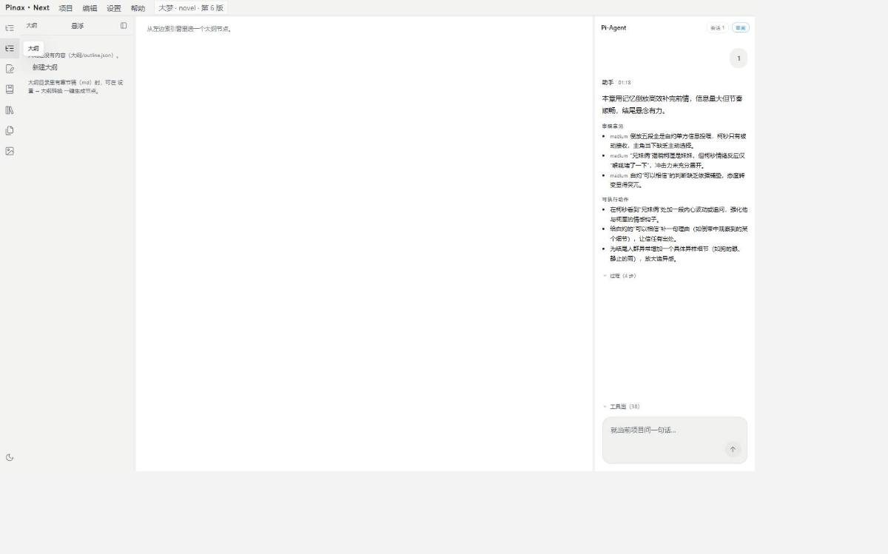
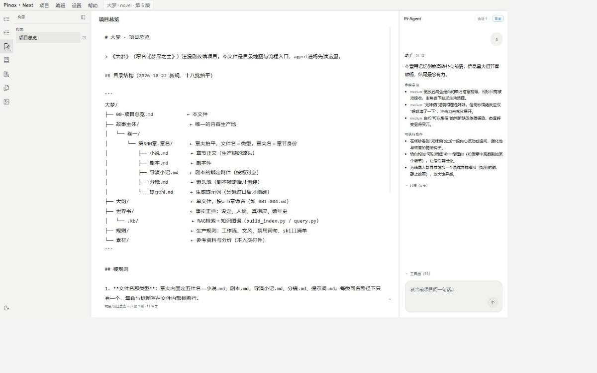
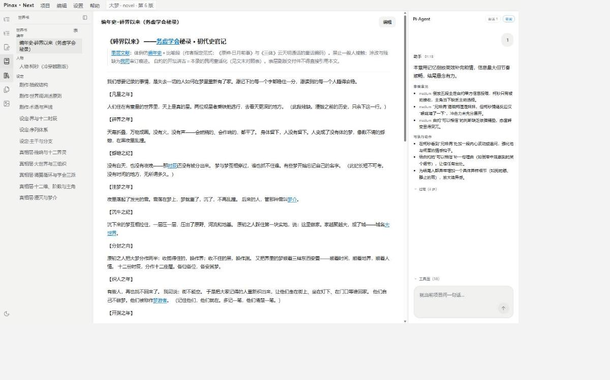
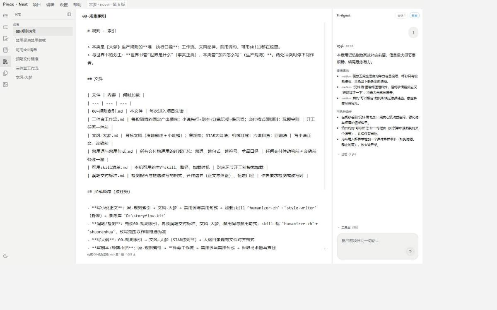
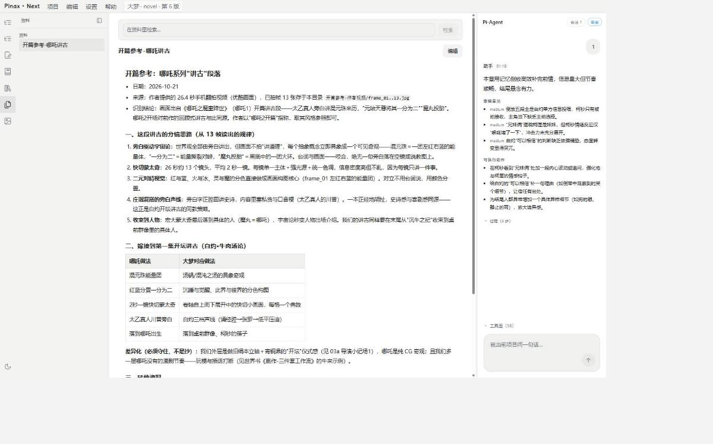
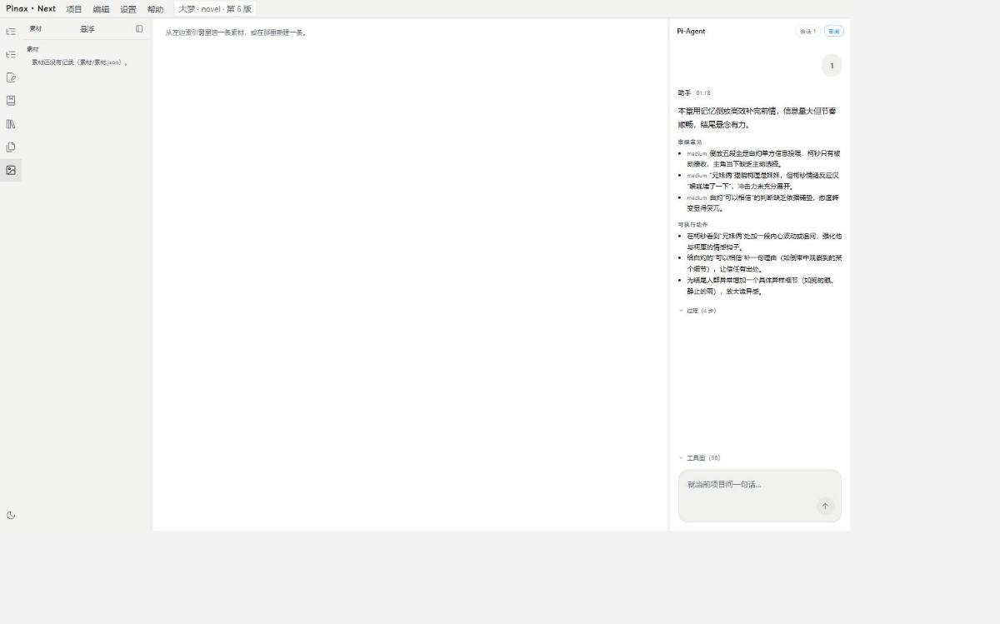
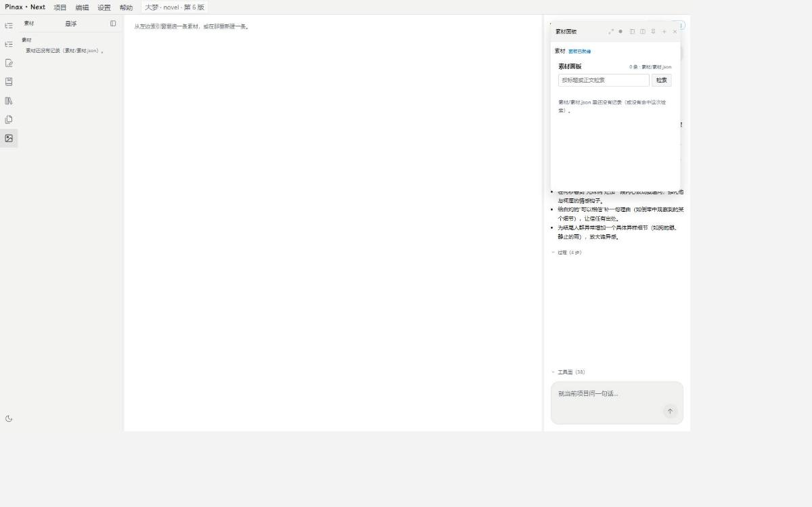
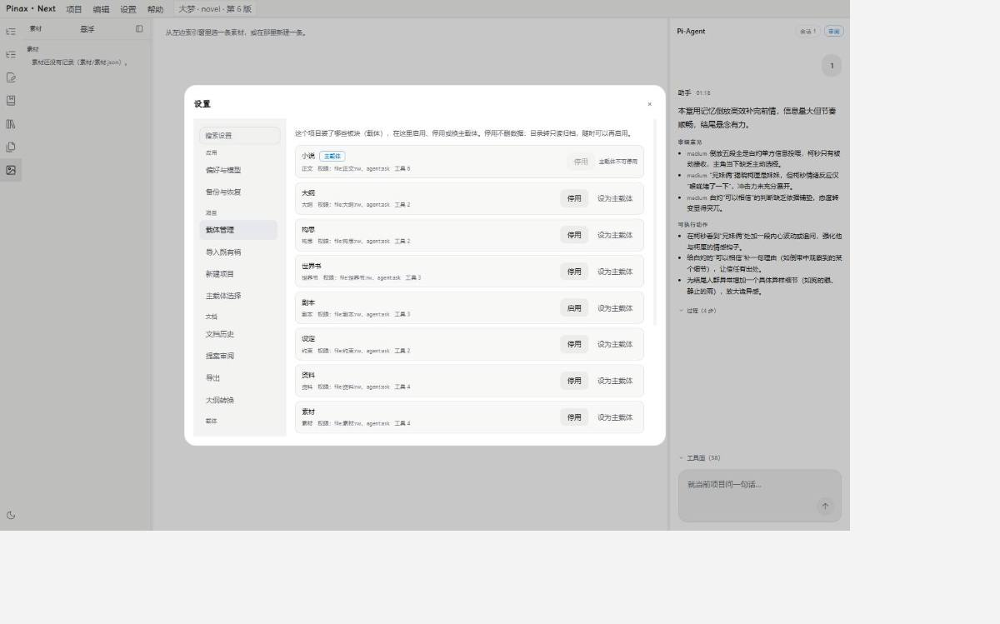
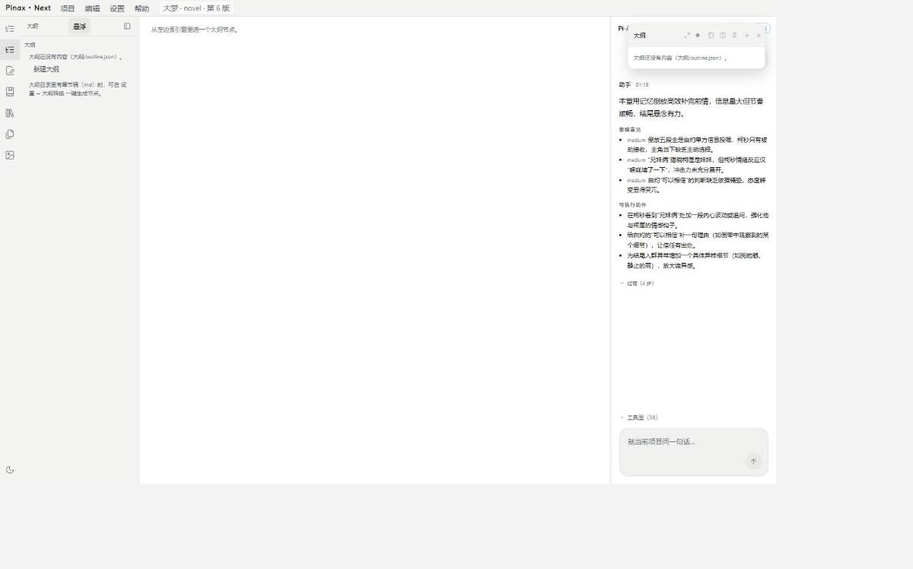

# Pinax.Next ·《大梦》协议 v3 落地实拍（2026-10-30）

## 结论先说

这一轮要办的三件事都办完了，而且是在真窗口里验的，不是设计稿。

1. **协议补完了**：载体清单升到 `pinax-carrier@3`（新增四张牌 `entry`／`services`／`mcp`／`agentMd`），项目合同升到 `pinax-project@3`。校验器 `next/kernel/carrierManifest.mjs:28` 认 v3 写、v2／v1 读；v3 里必须显式写 `manifestVersion: 3`（`next/kernel/carrierManifest.mjs:122`），v3 专属字段出现在旧 spec 里会被直接拒（`next/kernel/carrierManifest.mjs:126`）。
2. **已注册的插件全部改造完了**：12 个载体（小说／大纲／构思／世界书／剧本／设定／资料／素材／漫画／视频／体验／联机）现在都是 `spec: 'pinax-carrier@3'` + `manifestVersion: 3`，每份都写齐 `entry`／`services`／`mcp`／`agentMd` 四张牌（没有的就显式写空数组，不留洞）。
3. **《大梦》更新进去了**：`D:\Projects\大梦` 的项目合同已经是 `pinax-project@3`，主载体是小说，启用 7 块板（小说／大纲／构思／世界书／设定／资料／素材），拥有的目录是 `正文／大纲／构思／世界书／约束／资料／素材`。**C 盘原稿一个字没动**（见下面「C 盘原稿未动的证据」）。
4. **你看的方式**：真窗口截图 10 张（Playwright 真开 Electron，一次真启动），配一份自包含 HTML（图片内嵌，零路径依赖，手机可开）。

顺手修了两个只有真开窗口才暴露的产品缺陷，外加一处测试断言漂移——都写在「本轮修掉的东西」里。

---

## 一、协议 v3 补了什么

### 1.1 四张新牌各自解决什么

| 字段 | 解决什么 | 谁在用 | 证据 |
|---|---|---|---|
| `entry` | 载体可以自带一块自己的页面。宿主用 `pinax-plugin://<pluginId>/<相对路径>` 把它装进沙箱 iframe，页面只能走一条只读工具桥 | 素材（样板） | `next/kernel/carrierManifest.mjs:19`、`next/shell/PluginPanelHost.vue:9`、`next/shell/main.mjs:132` |
| `services` | 载体可以声明自己的本地子进程服务：启动命令／参数／环境／端口／健康检查／崩溃重启策略 | 目前 12 块都没起服务（显式空数组） | `next/kernel/carrierManifest.mjs:20` |
| `mcp` | 载体可以挂外部 MCP 服务端（stdio 或 SSE），挂进来的工具按 prefix 归命名空间 | 目前 12 块都没挂（显式空数组） | `next/kernel/carrierManifest.mjs:21` |
| `agentMd` | 载体自己的作者须知（插件目录内相对路径），运行时组上下文时并进去 | 12 块都有（各带一份 AGENT.md） | `next/kernel/carrierManifest.mjs:22`、`next/kernel/pluginRegistry.mjs:239` |

另外两处「不再猜」的收紧：

- **不再按 pane id 前缀猜内容面**。v3 的 pane 必须显式写 `kind` 和 `view`（`next/kernel/carrierManifest.mjs:463`、`next/kernel/carrierManifest.mjs:472`），宿主视图注册表按 `kind` 权威分派、`view` 只是类型名（`next/shell/viewRegistry.mjs:166`）。
- **`entry` 与 pane 必须成对**。只写 `entry` 没有 pane 挂它、只写 pane 没有 `entry`，两种都是「声明了却不生效」，校验器直接拒（`next/kernel/carrierManifest.mjs:171`）。

### 1.2 12 块载体改造后的声明（实测导出，不是手抄）

| 载体 | 目录 | 工具 | pane（槽位／id／kind） | entry | services | mcp | agentMd |
|---|---|---|---|---|---|---|---|
| 小说 | 正文 | 6 | left-dock `novel.shelf`／center `novel.editor`（chapter-editor） | — | — | — | AGENT.md |
| 大纲 | 大纲 | 2 | left-dock `outline.tree`／center `outline.editor`／**overlay `outline.widget`** | — | — | — | AGENT.md |
| 构思 | 构思 | 2 | left-dock `notes.list`／center `notes.editor` | — | — | — | AGENT.md |
| 世界书 | 世界书 | 3 | left-dock `worldbook.board`／center `worldbook.entries` | — | — | — | AGENT.md |
| 剧本 | 剧本 | 3 | left-dock `script.board`／center `script.editor` | — | — | — | AGENT.md |
| 设定 | 约束 | 2 | left-dock `setting.board`／center `setting.rules` | — | — | — | AGENT.md |
| 资料 | 资料 | 4 | left-dock `reference.board`／center `reference.documents` | — | — | — | AGENT.md |
| 素材 | 素材 | 4 | left-dock `material.board`／center `material.editor`／**overlay `material.panel`（custom-panel）** | `iframe:ui/index.html` | — | — | AGENT.md |
| 漫画 | 漫画 | 4 | left-dock `comic.board`／center `comic.editor` | — | — | — | AGENT.md |
| 视频 | 视频 | 4 | left-dock `video.board`／center `video.editor` | — | — | — | AGENT.md |
| 体验 | 体验 | 4 | left-dock `experience.board`／center `experience.editor` | — | — | — | AGENT.md |
| 联机 | 联机 | 4 | left-dock `online.board`／center `online.editor` | — | — | — | AGENT.md |

素材那块是**自带面板样板**（pane 在 `next/carriers/material/manifest.mjs:46`，四张牌在 `next/carriers/material/manifest.mjs:66`）：

```js
  // 自带面板（协议 v3）：内容面是插件自己的页面，宿主只给一块沙箱 iframe 与一条只读工具桥。
  { slot: 'overlay', id: 'material.panel', title: '素材面板', icon: 'image', view: 'pinax.view.custom', kind: 'custom-panel', width: 320, forms: ['overlay'] }
...
  entry: Object.freeze({ kind: 'iframe', path: 'ui/index.html' }),
  services: Object.freeze([]),
  mcp: Object.freeze([]),
  agentMd: 'AGENT.md'
```

### 1.3 运行面：真的起进程、真的连 MCP

`services` 与 `mcp` 不是纸面字段，宿主有实现，夹具也真跑：

- 服务监督器：起子进程、端口探测、健康检查、崩溃重启、日志收口。夹具在 `next/testing/fixtures/serviceHttp.mjs`、`serviceIdle.mjs`、`serviceCrash.mjs`。
- 外部 MCP 客户端：stdio 与 SSE 两条路都真连。夹具在 `next/testing/fixtures/mcpEchoServer.mjs`（stdio）、`mcpSseServer.mjs`（SSE）。
- 一个完整的夹具插件（声明 entry／services／mcp 三张牌）在 `next/testing/fixtures/plugin-demo/`。

**按约定没有接真 ComfyUI**——这一轮验的是宿主这条链本身。

---

## 二、《大梦》工作副本升 @3

### 2.1 磁盘实拍：`D:\Projects\大梦\.pinax\project.json`

```json
{
  "spec": "pinax-project@3",
  "schemaVersion": 3,
  "projectId": "proj_mvphyhp86ep0",
  "name": "大梦",
  "kind": "novel",
  "createdAt": "2026-10-26T16:54:39.645Z",
  "updatedAt": "2026-10-30T15:43:15.288Z",
  "carriers": {
    "primary": "pinax.carrier.novel",
    "enabled": [
      "pinax.carrier.novel",
      "pinax.carrier.outline",
      "pinax.carrier.notes",
      "pinax.carrier.worldbook",
      "pinax.carrier.setting",
      "pinax.carrier.reference",
      "pinax.carrier.material"
    ],
    "revision": 6
  }
}
```

对照上一代（@2）的差别：`@2` 没有 `carriers` 段（主载体／启用清单是另一处记账），`@3` 把「谁是主载体、哪些板启用」收进项目合同本身，并要求被引用的载体清单已按 `pinax-carrier@3` 写（`next/project/projectManifest.mjs:12`、`next/kernel/projectSkeleton.mjs:13`）。读侧仍兼容 @1／@2 的老项目。

### 2.2 《大梦》现在的目录实拍

```
D:\Projects\大梦\
├─ 正文\   001-第001章.md  002-延迟.md  003-倒带.md
├─ 大纲\   001-004.md                      ← 还是 md 章节稿，outline.json 尚未生成
├─ 构思\   项目总览.md
├─ 世界书\ 人物\  编年\  设定\
├─ 约束\   00-规则索引.md  三件套工作流.md  可用skill清单.md  文风-大梦.md  润笔交付标准.md  禁用词与禁用句式.md
├─ 资料\   开篇参考-哪吒讲古.md  世界书辅助\  章节衍生\
├─ 素材\   （空）                          ← 素材.json 还没落，等第一条记录
└─ .pinax\ project.json  workspace.json  sessions\  proposals\  state\  history.git\
```

目录名与载体清单里声明的 `dataDirs` 一一对上（正文→正文、大纲→大纲、构思→构思、世界书→世界书、约束→约束、资料→资料、素材→素材）。

### 2.3 C 盘原稿未动的证据

原稿在 `C:\Users\Administrator\D盘归档\写作\写作\Kit Project\大梦`。本轮做完后再查一次：

- 文件数 **86**、总字节 **1077933**——与 10-27 建工作副本时记下的数字完全一致。
- 全树最新修改时间是 **2026-10-26 15:25**（`pinax/.pinax/project.sqlite-wal`），正文／约束／资料等稿子文件最新是 2026-10-26 10:46。**本轮（10-30）没有任何一次写入落到这棵树上。**

也就是说：升 @3 只动了 `D:\Projects\大梦` 这份工作副本，C 盘那套 kit 布局的稿子一个字没碰。

---

## 三、真窗口实拍（10 张，一次 Electron 启动拍完）

采集方式：Playwright 真开 Electron（`next/.build/pinax-next-shell-main.mjs`），把 `PINAX_NEXT_ROOT` 指到 `D:\Projects\大梦`，按真实用户流点竖条、点树行、开浮窗、开设置。**页面控制台零报错**（`consoleErrors: []`，见 `docs/screenshots/next-dameng/2026-10-30/notes.json`）。窗口尺寸 1440×900。

### 01 · 全局：书稿与正文



三栏都在：左竖条七块板、索引窗是正文树（正文／第001章／延迟／倒带）、中栏是《倒带》这一章的正文（标题「倒带」，正文首段「# 第三章 倒带」，页脚显示 `正文/003-倒带.md 第 1 段 1579 字`）、右栏 Pi-Agent 里存着上一轮真实会话（01:18 的助手发言、审查意见 3 条、可执行动作 3 条、役牌 4 步、工具面 38）。标题栏 chip 显示 **大梦 · novel · 第 6 版**——第 6 版就是这次升 @3 之后重新计数的结果。

### 03 · 大纲：大纲树与章节



这一栏是空的，界面说清楚了为什么：中栏「从左边索引窗里选一个大纲节点。」，索引窗「大纲还没有内容（大纲/outline.json）。」外加一条出路：「大纲目录是重章节结构（md）时，可在设置 → 大纲转换一键生成节点。」——这是实情，《大梦》的大纲目录现在是 `001-004.md` 章节稿，还没转成节点树。

### 04 · 构思：构思清单



索引窗里是「项目总览」，中栏标题就是「项目总览」——选中一条后的详情面。

### 05 · 世界书：条目树



真条目，不是占位：编年·碎界以来（务虚学会秘录）／人物·柯秒（冷穿越剧版）／剧作·插叙结构／剧作·世界观讲述原则／剧作·术语与声线／设定·界与十二时辰／设定·序列体系。中栏显示选中那条的全文。

### 06 · 设定：约束规则树



六条真规则都在：00-规则索引、禁用词与禁用句式、可用skill清单、润笔交付标准、三件套工作流、文风-大梦。中栏是「00-规则索引」正文。

### 07 · 资料：资料文档树



「开篇参考-哪吒讲古」在树上，中栏是它的全文——这一份是真读出来的内容，不是文件名。

### 08 · 素材：素材库（空库）



索引窗标题行右侧现在有一枚「悬浮」钮（协议 v3 新增的入口）。素材库本身是空的，界面写明：「素材还没有记录（素材/素材.json）。」中栏提示「从左边索引窗里选一条素材，或在那里新建一条。」

### 09 · 素材：自带面板（协议 v3 的 entry 面）



**这一张是这一轮的关键证据。**点「悬浮」之后，右上角浮出一扇「素材面板」窗——里面跑的是**插件自己的页面**（`next/carriers/material/ui/index.html`，经 `pinax-plugin://` 协议装载，落在 `sandbox="allow-scripts"` 的 iframe 里，宿主只给一条只读工具桥）。面板自己显示：「素材 面板已就绪」、「素材面板 0 条 · 素材/素材.json」、一个「按标题或正文检索」的输入框加检索钮，以及「素材/素材.json 里还没有记录（还没有命令过这次检索）。」——工具桥真的通了（它能读到记录数、能说明为什么是 0 条），但它只读、不写盘。

### 10 · 设置 → 载体管理：清单与协议 v3



这一屏就是「协议 v3 清单」在界面上的样子：一块板一块板列它声明了什么（目录／权限／agentask／工具数），并给停用／设为主载体的动作。小说是主载体（标着「主载体」，只可停用不可换主）；其余 7 块是《大梦》当前启用的（按钮写「停用」＝点了会停掉）；剧本那一行按钮写「启用」＝它在本项目里没启用。这一屏列的是全局 12 块载体，不是《大梦》的启用名单。

### 11 · 大纲：悬浮小窗与大纲转换入口



大纲板声明的 overlay 槽 pane（`outline.widget`）开成了浮窗，浮窗里是同一句实话：「大纲还没有内容（大纲/outline.json）。」左边索引窗同时给出「设置 → 大纲转换」的指引。

---

## 四、本轮修掉的东西（都是真开窗口才暴露的）

1. **Electron 在带参数的启动器下不起窗**（真缺陷）。`next/shell/main.mjs:599` 原来判「`process.argv[1]` 恰好是入口文件」才自启，而 Playwright 会把 `--inspect=0 --remote-debugging-port=0` 插在应用路径前面，`argv[1]` 就不是入口文件了 → 永远不起窗。改成：argv 里任何一项指到本文件即算，打包态（`app.isPackaged`）直接算。
2. **自带面板声明了却点不开**（真缺陷）。「悬浮」钮原来只在大纲那一栏里，于是素材这类自带面板在清单里声明着、运行时也渲染得出来，作者却没入口。现在这枚钮挪到索引窗标题行，每一块声明了 overlay 槽的载体都出（`next/shell/IndexWindow.vue:449`）。
3. **测试断言漂移**（不是回归）。外壳 UI 那 12 条用例还在找旧的 `[aria-label="悬浮大纲"]`。按规矩改断言、注明理由，不静默改绿：改按类名 `.nx-index-overlay-btn` 找（`next/tests/shell-ui.spec.mjs:2117`、`next/tests/shell-ui.spec.mjs:2444`）。
4. **一条 MCP 用例在整机负载高时会抖**（不是回归）。批量连接那批里混着要真起 node 子进程的 stdio 夹具，500ms 的 timeout 在满负载时够不到握手，夹具被误判成失败。给批连接的 timeout 放宽到 5s，用例要验的「哪台失败只记账」没变（`next/tests/mcp-client.test.mjs:67`）。
5. **一条真链路 UI 用例在满负载下会超时**（不是回归）。`carrier-pane-real.spec.mjs` 那组每条都要真建工程、真读磁盘，vitest 默认 5s 单测时限在满载时不够（空载时整组 0.9s 跑完）。单测时限放到 30s，行为断言一条没减（`next/tests/carrier-pane-real.spec.mjs:115`）。

---

## 五、已知瑕疵（如实列）

- **《大梦》的大纲还没转成节点树**：`大纲/` 里仍是 `001-004.md` 章节稿，`outline.json` 未生成，所以大纲板和它的悬浮窗都是空态。界面给了入口（设置 → 大纲转换），但这一轮**没有代作者点**——转不转是作者的决定。
- **素材库是空的**：`素材/素材.json` 还没落盘，第一条记录写入时才创建。这不是坏了，是真没有素材记录。
- **截图带一点渲染留白**：Electron 渲染面（1440×900 设备像素）与 CSS 画布（1694×1058）尺寸不一致，初次截图右侧／底部留了一圈没画到的白边。交付版已由打包脚本按「非白像素包围盒」裁掉并压到宽 1200（`scripts/tmp-next-dameng-showcase-html.mjs`），裁前原图没另存。
- **01 与 02 是同一屏**：竖条第 2 格「小说」就是默认打开的那块，第一版采集时留了两张一模一样的图，第二版已删掉重复的那张，现在 10 张。
- **服务与 MCP 在 12 块载体里都还是空的**：这一轮只把协议位子和宿主实现铺好，真实外部服务（ComfyUI 等）按约定没接。
- **原生滚动/缩放细节未做**：本轮没验高 DPI 缩放下的浮窗坐标（`workspace.json` 里 geometry 仍为 null）。

---

## 六、复现方式（命令级）

```bash
cd D:/Pinax-main/Pinax-main

# 1) 重建（改了 next/ 源码就要重建，门禁不负责重建）
npm run next:build:main
npm run next:build:shell

# 2) 门禁
npm run verify:next

# 3) 真开《大梦》（自己看）
npm run next:shell          # 或直接跑 next/.build/pinax-next-shell-main.mjs，PINAX_NEXT_ROOT=D:\Projects\大梦

# 4) 重拍这 10 张图
node scripts/tmp-next-dameng-capture.mjs

# 5) 重出交付版（裁边压宽 + 自包含 HTML）
node scripts/tmp-next-dameng-showcase-html.mjs
```

采集脚本现放在 `scripts/tmp-next-dameng-capture.mjs`（tmp 前缀＝临时件，作者要正式化或删掉随时说）。截图产物在 `docs/screenshots/next-dameng/2026-10-30/`，同目录 `notes.json` 存着每张图当场读到的 DOM 文字证据。交付版 HTML 是 `docs/plan/next-dameng-showcase-2026-10-30.html`（图片全部内嵌，零路径依赖，手机上直接打开就能看图）。

---

## 七、门禁数字

`npm run verify:next` ＝ 验收脚本 ＋ node 单测 ＋ 外壳 UI 单测 ＋ lint ＋ 打包断言，五段全过才算绿。本轮最终实跑（2026-10-31 凌晨）全绿：

| 段 | 结果 |
|---|---|
| 验收脚本（`next/testing/acceptance.mjs`） | **20/20 通过** |
| node 单测（`next/tests/*.test.mjs`） | **487/487 通过** |
| 外壳 UI 单测（vitest） | **138/138 通过**（6 个文件） |
| lint（eslint next --max-warnings 0） | **0 warning** |
| 打包断言（`next/testing/bundleAssertions.mjs`） | 全部通过 |

打包断言里的具体数字：主进程 bundle **1179.8 kB**（门限 6 MB）、外壳 bundle **1929.8 kB**（门限 2.5 MB）、渲染层 js **927.1 kB**、渲染层 CSS **146.8 kB**（带着老前端的控件词汇与 token，明暗两套）、preload **4.2 kB**；技能包 5/5 进包并可装载（chapter-rewrite／continuity-check／outline-restructure／scene-expand／worldbook-refactor）；十二块载体的 AGENT.md 真在盘上且路径对得上；自带面板页从自己的插件目录供出、越界与不存在都拒、面板页不许有行内脚本。

门禁跑法提醒：`verify:next` **不负责重建**，改了 `next/` 源码要先 `npm run next:build:main` 与 `npm run next:build:shell`，否则验的是旧包。
